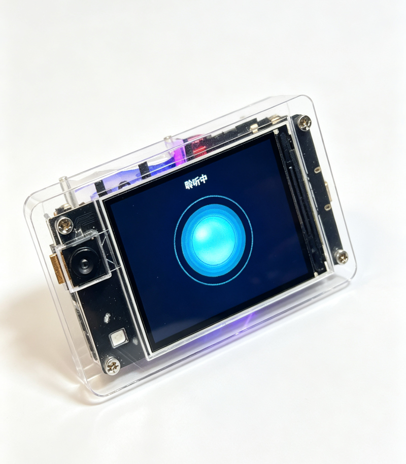

# 大飞鱼 S3 智能小车



> 抖音创客久久 · 基于 ESP32-S3 的桌面 AI 小车 / 语音助手
>
> 在小智 AI（xiaozhi-esp32）基础上深度定制：加了小车驾驶、图传、三套界面、表情引擎和整套网页控制台。

---

## 这是什么

一块 ESP32-S3 的桌面小车主板：屏幕会眨眼、会说话、能看图，能被网页遥控满屋跑。

- **本体**是完整的语音助手：唤醒词唤醒 → 语音对话 → 大模型回答 → 语音播报，支持说话打断。
- **小车形态**下屏幕换成一整张会动的脸（21 种情绪），同时通过 ESP-NOW 指挥一台 C3 从机驱动轮子。
- **网页控制台**在设备自己身上跑（不需要连外网），手机/电脑浏览器打开设备 IP 就能遥控、看图传、调参数。

---

## 功能一览

### 语音

- 唤醒词唤醒（`你好小智`，可网页切换唤醒词模式）
- AEC 回声消除，支持"说话时打断"
- 待机语音处理关闭、只留唤醒词，省电又不抢麦克风

### 三种界面模式

开机弹出三选一列表，默认选中上次用的那项，3 秒不按键自动进入：

| 模式 | 说明 |
|---|---|
| 主题模式 | 横屏 320×240，待机时钟 / 壁纸 / 角色，音乐可视化 |
| 小车模式 | 竖屏 240×320，整屏表情接管，待机显示时钟 |
| 字幕模式 | 整屏文字：顶部状态、上半 AI 回复、下半我说的话 |

### 小车

- 全屏表情引擎：21 种情绪、自动眨眼、呼吸、说话嘴型、弹跳/抖动/泪滴
- 行驶装饰动作（前进/后退/转向/转圈/跳舞…）由 MCP 工具直接驱动
- ESP-NOW 主从链路：5 Hz 遥测回传速度、障碍距离、跌落距离
- 障碍/临边自动换向继续走（自主探索模式）
- 距离保护：可网页设置阈值，触发即拦停

### 图传与网页

- MJPEG 图传 10 fps（320×240，独立 81 端口）
- 网页控制台（80 端口）：主页状态、摇杆、方向键、自主探索、电机速度、语音打断、唤醒词、屏幕、灯效、距离保护、待机省电
- 图传页与摇杆同屏，手机横屏就是遥控器

### 其它

- 拍照识别（摄像头拍照交给大模型描述）
- 音乐可视化：频谱条、歌名、歌词跟随
- 电量、芯片温度、内存占用实时显示
- 待机自动降亮度（时长可配，默认 3 分钟）

---

## 硬件

| 部件 | 规格 |
|---|---|
| 主控 | ESP32-S3（16 MB Flash + 8 MB PSRAM） |
| 屏幕 | ST7789 LCD，320×240（横屏）/ 240×320（竖屏） |
| 摄像头 | GC0308 |
| 麦克风 | ES7210 四麦阵列（TDM） |
| 音频输出 | I2S 功放 |
| 灯效 | WS2812 |
| 底盘 | C3 从机 + MX1508 双路 H 桥（ESP-NOW 通信） |

板型定义在 `main/boards/zhengchen/cam/`，引脚见同目录 `config.h`。

---

## 编译与烧录

需要 ESP-IDF **v5.5** 及以上。

```bash
# 1. 设置目标芯片
idf.py set-target esp32s3

# 2. 选择板型（menuconfig → Xiaozhi Assistant → Board Type）
#    选 Zhengchen Cam；或直接用默认配置文件：
#    sdkconfig.defaults / sdkconfig.defaults.esp32s3 / sdkconfig.defaults.zhengcam

# 3. 编译
idf.py build

# 4. 烧录（把 COMx 换成自己的串口）
idf.py -p COMx flash monitor
```

首次开机进入配网：设备自建热点，用手机连上后按提示填 WiFi。

> 静态 IP、唤醒词、界面模式、电机参数等都存在 NVS 里，可通过网页或语音修改，不需要重新编译。

---

## 目录结构（主要部分）

```
main/
├── application.cc              对话主流程、协议消息处理、状态机
├── audio/                      音频管线、AEC、唤醒词、Opus 编解码
├── display/                    显示抽象、LVGL 封装
└── boards/
    └── zhengchen/cam/          本项目的板级实现
        ├── zhengchen_cam_board.cc   板级初始化、按键、相机、ESP-NOW
        ├── dafeiyu_display.cc       主题/小车/字幕三模式、界面与动画
        ├── dafeiyu_web.cc           80 端口网页控制台与全部 API
        ├── cam_stream.cc            81 端口 MJPEG 图传
        ├── robo_face.cc             表情层（LVGL canvas）
        ├── xiaozhi_face_tft.h       21 情绪表情引擎
        ├── car_action.cc            行驶装饰动作
        └── esp_now_link.cc          主从链路与遥测
```

---

## 鸣谢

本项目的绝大部分底座来自开源社区，特此致谢：

- **小智 AI（xiaozhi-esp32）** —— 语音对话框架、MCP 协议、板级抽象与音频管线，本项目在其之上做定制。原始版权归其作者与贡献者所有，遵循 MIT 许可证。
- **Espressif ESP-IDF** —— 芯片 SDK、FreeRTOS、lwIP、esp_http_server、esp_camera、esp_codec_dev。
- **LVGL** —— 全部界面渲染。
- **xiaozhi_face_tft** —— 本机配套的 21 情绪 TFT 表情引擎（与 OLED 版同源）。
- 以及所有在小智生态里提交过代码、提过 issue 的开发者。

如果你在自己的项目里用了本仓库的代码，也欢迎在 README 里提一句。

---

## 许可证

沿用上游 MIT 许可证，见 [LICENSE](LICENSE)。原始版权声明保留：

```
Copyright (c) 2025 Shenzhen Xinzhi Future Technology Co., Ltd.
Copyright (c) 2025 Project Contributors
```

在本项目基础上新增/修改的代码同样以 MIT 发布。
